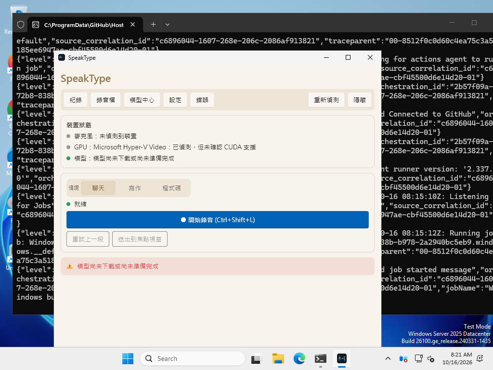
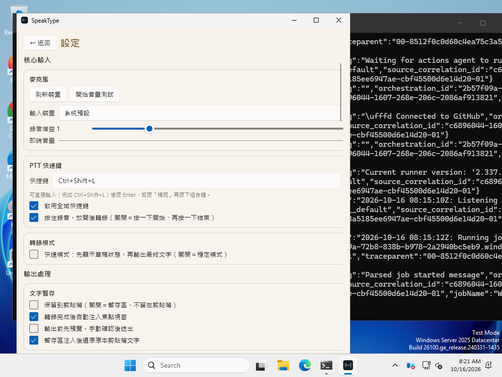
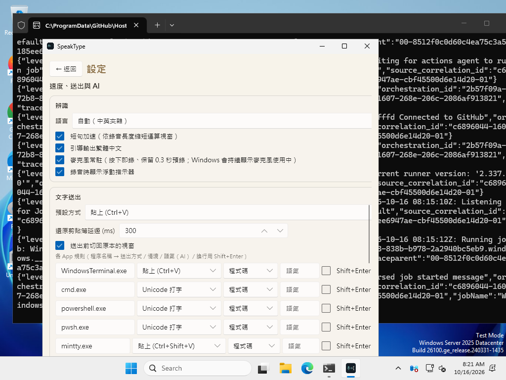
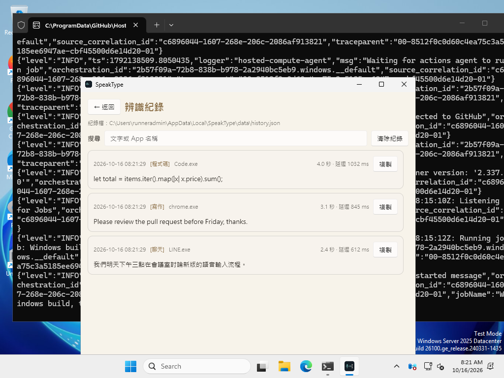
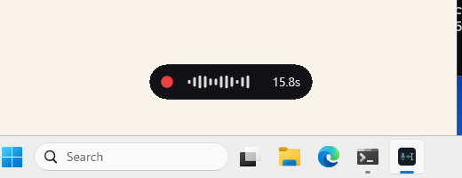

# SpeakType

[English](README.en.md)

Windows 上的本機語音輸入工具：按住快捷鍵說話，放開後文字就出現在目前游標所在的程式（Chrome、Office、記事本、LINE、終端機…）。語音辨識使用 [whisper.cpp](https://github.com/ggml-org/whisper.cpp)，完全在本機執行；AI 潤稿為選用功能，可接本機 Ollama 或雲端 API。



📖 完整使用說明：[docs/USER_GUIDE.zh-TW.md](docs/USER_GUIDE.zh-TW.md)　｜　更新紀錄：[CHANGELOG.md](CHANGELOG.md)

> 目前最新版本為測試版 **v0.5.4**（`test` 分支），只支援 Windows x64。

## 下載與安裝

到 [Releases](https://github.com/stevenke1981/speaktype/releases) 下載：

- `speaktype-setup-windows-x64.exe`：安裝程式（建議）。繁中／英文介面，可選「只為我安裝」（不需系統管理員）或安裝給所有使用者，可勾選登入時自動啟動。
- `speaktype-windows-x64.zip`：免安裝版，解壓縮後執行 `speaktype.exe`。
- `SHA256SUMS.txt`：檔案校驗碼。PowerShell 驗證：`Get-FileHash .\speaktype-setup-windows-x64.exe -Algorithm SHA256`

Windows SmartScreen 可能提示「未知的發行者」（程式沒有程式碼簽章），按「其他資訊 → 仍要執行」。

## 要選哪個版本（CPU / Vulkan / CUDA）

| 版本 | 適合 | 安裝程式大小 |
|---|---|---|
| CPU（`speaktype-setup-windows-x64.exe`） | 所有電腦，最小 | 約 13 MB |
| Vulkan（`speaktype-vulkan-setup-windows-x64.exe`） | 有 NVIDIA／AMD／Intel 顯示卡 | 約 17.7 MB |
| CUDA（`speaktype-cuda-setup-windows-x64.exe`） | NVIDIA GTX 10 系列以上、驅動 R525+；安裝時另從 NVIDIA 官方下載約 430 MB | 見 Release 頁 |

GPU 版在找不到驅動程式或元件時會自動改用 CPU；「設定 → 辨識硬體」可選 自動／GPU／CPU，並顯示目前使用的後端。

## 快速開始

1. 安裝後啟動 SpeakType。
2. 第一次使用時到「模型中心」下載語音模型（預設 `large-v3-turbo` q5_0 量化版，約 547 MB）。
3. 點一下要輸入文字的地方（例如記事本），按住 `Ctrl+Shift+L` 說話，放開後文字會自動送出。

## 模型與存放位置

- 模型從 Hugging Face（`huggingface.co/ggerganov/whisper.cpp`）下載，支援續傳，有 SHA256 時會自動校驗。
- 新下載的模型存放在 `%LOCALAPPDATA%\SpeakType\models`（例如 `C:\Users\你\AppData\Local\SpeakType\models`）。
- 如果設定的模型資料夾無法寫入（例如在 `C:\Program Files` 底下），v0.5.1 起會自動改用上面的使用者資料夾；舊位置（設定的資料夾、程式旁的 `models\`）裡已有的模型仍會直接使用。

| 模型 | 大小 | 建議 |
|---|---|---|
| large-v3-turbo (q5_0) — 預設 | 約 547 MB | 品質接近原版，下載小、載入快 |
| large-v3-turbo | 約 1.6 GB | 品質優先，建議 NVIDIA GPU |
| medium | 約 1.5 GB | 平衡，GPU／高階 CPU |
| small | 約 488 MB | 速度優先 |
| small (q5_1) | 約 181 MB | 低階 CPU／筆電最快 |
| base | 約 142 MB | 極速、準確度較低（英文為主） |

## 使用方式

| 動作 | 說明 |
|---|---|
| 按住 `Ctrl+Shift+L` 說話，放開送出 | 按住說話（push-to-talk，預設） |
| 按一下開始、再按一下結束 | 切換模式：設定 →「按住錄音，放開後轉錄」取消勾選 |
| 螢幕下方的小膠囊 | 錄音中顯示紅點與音量，轉寫中顯示「轉寫中」 |
| 主視窗 → 紀錄 | 辨識歷史：搜尋、複製、看每次延遲與目標 App |

## 功能（對齊 Typeless）

| Typeless 功能 | SpeakType | 說明 |
|---|---|---|
| 按住說話／切換快捷鍵 | ✅ | 兩種模式皆可，快捷鍵可自訂 |
| 去除贅字（嗯、呃、um、uh） | ✅ 本機 | 只刪句首與單獨出現的贅字，不會誤刪「這個方案」 |
| 口誤自動更正 | ✅ 本機 | 「三點開會，不對，四點開會」→「四點開會」；支援「我是說」「I mean」「scratch that」 |
| 自動標點、條列整理 | ✅ 本機 | 「第一…第二…」「首先…其次…」「first… second…」→ 1. 2. 條列 |
| 個人詞典 | ✅ | 自訂詞同時當作辨識提示詞（提高命中）與輸出替換；可保護不被簡繁轉換 |
| 依 App 調整語氣／格式 | ✅ | 依前景程式自動選情境（聊天／寫作／程式碼）、送出方式、AI 語氣 |
| 多語言、中英夾雜 | ✅ | 語言預設「自動」，中文一律輸出繁體（台灣用語），英文維持原文 |
| 歷史紀錄 | ✅ | 最近 200 筆，含延遲與目標 App |
| 精簡浮動錄音指示器 | ✅ | 不搶焦點、可點穿 |
| AI 潤稿 | ✅ 選用 | OpenAI 相容 API：本機 Ollama／LM Studio，或 OpenAI、Groq 等（需金鑰）；逾時或失敗時自動改送本機整理結果 |
| 雲端辨識 | ➖ | 刻意不做：辨識全程在本機，音訊不離開電腦 |
| 選取文字後語音改寫／翻譯 | ❌ | 尚未實作 |
| macOS／iOS | ❌ | 目前只支援 Windows |

## 文字送出

| 方式 | 適用 |
|---|---|
| 貼上 (Ctrl+V) — 預設 | Chrome、Office、記事本、LINE、Windows Terminal。先備份剪貼簿（文字或圖片），貼上後在背景還原；若期間剪貼簿被你改過就不還原 |
| 貼上 (Ctrl+Shift+V) | mintty／Git Bash 等終端機 |
| Unicode 打字 | cmd、PowerShell 主控台、遠端桌面。用 `SendInput` 一次送出，繞過輸入法（注音輸入法開著也不會被攔截），支援中日韓文與 emoji，不碰剪貼簿 |
| 只複製 | 只放到剪貼簿 |

送出前會等你放開 Ctrl／Shift／Alt（避免變成 Ctrl+Shift+V），並切回放開快捷鍵時的視窗。設定 →「速度、送出與 AI」可以為每個程式（例如 `LINE.exe`）指定送出方式、情境、AI 語氣，以及換行是否改送 Shift+Enter（避免聊天軟體直接送出）。

> 目標程式以系統管理員權限執行時，Windows 會擋下模擬按鍵，請也用系統管理員權限啟動 SpeakType。

## AI 潤稿（選用）

設定 →「AI 潤稿」勾選啟用，按「本機 Ollama」（先 `ollama pull qwen2.5:3b`）或填入任何 OpenAI 相容端點與金鑰。金鑰以純文字存在 `config.toml`，也可以用環境變數 `SPEAKTYPE_AI_API_KEY`。

## 速度

放開快捷鍵到文字送出，在 8 核 CPU（無 GPU）上的實測（11–13 秒的錄音）：

| 模型 | 0.3.1 | 0.4.0 |
|---|---|---|
| large-v3-turbo，中文 | 20.2–21.0 秒 | 7.7–9.9 秒 |
| large-v3-turbo q5_0（新預設），中文 | — | 6.7–9.7 秒 |
| base，英文 | 3.4–3.6 秒（被強制當中文，輸出錯誤） | 0.38–0.45 秒（正確英文） |

主要改善：重用 whisper 狀態、依錄音長度縮短 encoder 視窗、用滿 CPU 核心、模型載入後暖機、麥克風常駐（按下即錄＋0.3 秒預錄）、VAD 在 16 kHz 單聲道上執行、錄音檔改在送出後才寫入、快捷鍵事件立即喚醒介面（原本縮到系統匣時最多延遲 0.5 秒）、剪貼簿還原改在背景執行。細節見 [docs/PERFORMANCE.md](docs/PERFORMANCE.md)。

有 NVIDIA 顯示卡可以自行用 `cargo build --release --features cuda` 編譯 CUDA 版（見 [PACKAGING.md](PACKAGING.md)）。

## 截圖

| 設定 | 速度、送出與 AI | 紀錄 |
|---|---|---|
|  |  |  |

錄音指示器：

## 常見問題

- **下載模型顯示「存取被拒」**：請更新到 v0.5.4 以上，模型會改存到 `%LOCALAPPDATA%\SpeakType\models`。若設定中手動指定了 `C:\Program Files` 底下的資料夾，請改成使用者資料夾。也可能是防毒軟體鎖住下載中的 `.bin.part` 檔，可暫時排除該資料夾。
- **一直停在「轉寫中」或很慢**：請更新到 v0.5.4 以上（CPU 版約快 5 倍，並有逾時保護）。有 NVIDIA 顯示卡請改裝 `speaktype-cuda` 版本，在「設定 → 辨識硬體」選自動或 GPU；需 NVIDIA 驅動程式 R525 以上。
- **按快捷鍵沒反應／文字沒有送出**：目標程式以系統管理員執行時，請也用系統管理員執行 SpeakType；確認設定中「啟用全域快捷鍵」已勾選。
- **沒有聲音／辨識空白**：到「設定 → 輸入裝置」選對麥克風、看「即時音量」；Windows「設定 → 隱私權 → 麥克風」需允許桌面應用程式存取麥克風。
- **防毒軟體誤報**：程式沒有簽章，且會模擬按鍵與讀寫剪貼簿，可能被標記；可用 `SHA256SUMS.txt` 確認檔案與 Release 一致。
- 更多內容見 [使用說明](docs/USER_GUIDE.zh-TW.md#疑難排解)。

## 介面（v0.5）

v0.5 起介面改用 [Slint](https://slint.dev)（原為 egui）。Windows 預設使用 Skia 繪製，無法使用時依序退回 Skia 軟體繪製、Slint 軟體繪製；中文字型依序使用 Microsoft JhengHei UI → Microsoft YaHei UI → PMingLiU → SimSun。

- 改為事件驅動：閒置時不重繪。CI 量測 30 秒閒置：

| 平台 | 閒置 CPU（0.4.0 egui → 0.5 Slint） | 記憶體 |
|---|---|---|
| Windows | 單核 47.8% → 0% | 工作集 151 MB → 154 MB |
| Linux | 0% → 0% | RSS 174 MB → 40–48 MB |

- 代價：Windows `speaktype.exe` 因內建 Skia 從 19.1 MB 增加到 36.7 MB（安裝程式約 12.8 MB）。
- 錄音指示器改成獨立的小視窗：無邊框、透明、置頂、不搶焦點、不顯示在工作列。指示器後方不會再出現深色方塊。
- 關閉或最小化視窗會縮到系統匣，快捷鍵在背景照常運作。

## 從原始碼編譯

需要 Rust stable、CMake、LLVM/Clang、Visual Studio C++ 工具。

```powershell
cargo build --release              # CPU 版
cargo test --release
./scripts/build-installer.ps1      # Inno Setup 安裝程式 → dist\
./scripts/package-portable.ps1     # 免安裝 zip → dist\
target\release\speaktype-bench.exe models\ggml-base.bin sample.wav 3   # 延遲測試
```

## 資料位置

`%LOCALAPPDATA%\SpeakType\`：`config\config.toml`、`data\history.json`、`recordings\`、`models\`、`logs\`。解除安裝時會詢問是否一併刪除（靜默解除安裝加上 `/PURGE` 才會刪除）。
